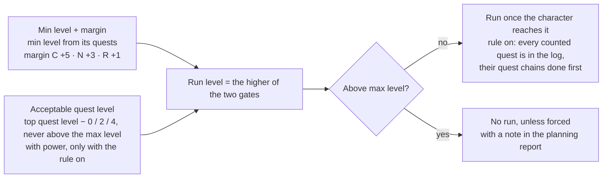

# Spec: safer dungeon run levels

## Problem

Guides plan the Deadmines at level 15, too dangerous to run, because a dungeon's earliest run level comes from when its quests can be *taken*, not from when the dungeon is safe.

- **Run level today** (`model/dungeons.rs` `set_dungeon_levels`): the lowest `min_level` of the dungeon's quests, but at most 2 below its lowest quest level. This spec adds no per-dungeon level setting: players get only the two global settings below.
- **Not tied to the play style or power**: quest objectives use the progression profile and the character's power (`Params::level_for`); a dungeon run only checks `s.level >= min_level` (`plan/step.rs` `gate_level_at`, `plan/construct.rs` `dungeon_ready`).
- **Quests before the run**: the first route waits for the dungeon quests takeable at that level and worth it (`dungeon_ready`), but the search then moves the run freely: the simulation only checks the level.
- **What a player can do**: exclude the dungeon in the Dungeons panel, losing it and its quests.

## Decisions

Two new settings: a safety margin on every dungeon's run level, on by default, and a wait-for-quests rule, off by default.

| # | Rule | Decided |
| --- | --- | --- |
| D1 | **Safety margin**: a run waits until the dungeon's computed minimum level plus a margin. | Default by play style: cautious +5, normal +3, risky +1 levels. A number setting overrides it. On by default. |
| D2 | **Wait-for-quests rule**: a run waits until every takeable quest of the dungeon is in the log and all of them are at an acceptable level. | One global switch, for every run (forced or automatic). Off by default. |
| D3 | Quests that count: every quest of the dungeon for the character's race, faction and class, not excluded by the player, and the class quests of the other group members. Each must be taken before the run, its prerequisites and earlier chain quests done by the route first, so that it can be completed in the run. Never counted: quests started inside the dungeon, which can only be taken during the run. | The route must take them all, their chains first, even those not worth it on their own. A counted quest whose chain cannot be done (a prerequisite excluded, or in an excluded zone) means the dungeon is not run (D6). |
| D4 | Acceptable quest level: the highest level among those quests, minus the character's power, at most 0 (cautious), +2 (normal), +4 (risky). Never above the dungeon's max level: if the quests would push it past, the max level is used. | A number setting overrides the play style's value. |
| D5 | Power counts: the character's power (class, gear, class quests and spells, as `Params::reach` without the play style margin) stands in for its level. | Good gear lets the run happen a little earlier. |
| D6 | When the rule cannot be met (log full, a counted quest's chain that cannot be done, a quest's minimum level too high, the run level reached only past the target level), the dungeon is not run (a forced one still runs, D7): a run happens only once every rule is met, and the planning report says why. | Same when the safety margin goes past the max level. |
| D7 | Forced dungeons always run. Their rules become goals: the route stays valid when one is unmet, but each unmet rule costs the search time (a counted quest missing, each level below the run level), so it meets as many as it can, and the planning report lists those left unmet. Automatic dungeons run only once their rules are met (D6); excluded ones never run. | Respects the player's choice to force a dungeon. |

## The run level rule

With the rule off, only the top gate counts: today's minimum level plus the play style's margin.

## Ideas and key info for implementation

The implementer chooses the design; these are the places and traps found while writing the spec.

- **Where the run level is checked today**: `plan/step.rs` `gate_level_at` (`Kind::Dungeon`, then `grind_to_gate` grinds to it) and `plan/construct.rs` `dungeon_ready`. Both use the fixed `Dungeon::min_level`; the new run level depends on the state (level and power), like `Combat::guard_level` for objectives.
- **Making the search obey the quest rule**: the search moves dungeon stops freely and only `Availability::valid` stops it. An invalid stop makes `simulate` reject the whole route (`plan/evaluate.rs`), so the rule likely belongs there; the guide editor (`plan/edit.rs`) uses the same check.
- **Power**: `Params::reach` gives a character's power at a level; `Params::level_for` inverts it but adds the play style margin, which the acceptable level replaces (D5).
- **Counted quests** (D3): `model.quests` is already filtered for the character's race, faction and class, and holds the group's class quests. `Quest::start_dungeon` marks quests started inside. `Availability::dungeon_quests(d)` lists a dungeon's quests. A quest's chain is in Quest::pre\_all, pre\_any and pre\_held; Availability::chain\_after walks it the other way.
- **Construction**: `dungeon_ready` already waits for the dungeon quests that are takeable and worth it (`Worth::worth_it`); the rule needs every takeable one, worth it or not.
- **No run**: `search.rs` `drop_dungeonless` already removes the quests of a dungeon never run; the planning report (`plan/report.rs`) is where to say why a run did not happen (D6).
- **Settings**: new fields in `Params` need `#[serde(default)]` so saved guides read as before; the app's settings form is generated from `app/src/paramSchema.ts` (Dungeons section), its texts in every language's catalog.
- **Soft rules for forced dungeons** (D7): the search's cost is already the route's time plus weights (`Params::mandatory_penalty` for a class quest left out, `abandon_weight`, `zone_change_weight`); the unmet rules of a forced run could add a penalty the same way, steep enough that meeting a rule is almost always worth it.

## Tests and acceptance

Done when the unit tests pass and a normal-style Human guide no longer runs the Deadmines at 15.

**Unit tests** (`cargo test -p fg-route`)

- Margin: 5 / 3 / 1 for cautious / normal / risky, and the setting overrides it. Acceptable quest level: 0 / 2 / 4.
- Power: a character with good gear reaches the same acceptable level at a lower level than one with plain gear.
- Rule off: a dungeon with min level 15 and max level 26 runs from 20 on cautious, 18 on normal, 16 on risky.
- Rule on, highest quest level 22, power equal to the level: the run waits until 22 on cautious, 20 on normal, 18 on risky; with a highest quest level of 32, the acceptable level is held at the dungeon's max level (26).
- Rule on: a run with a takeable counted quest not in the log is invalid; so is a run before a counted quest's prerequisite is done; a counted quest whose chain cannot be done at all (excluded prerequisite or zone) means no run.
- Counted quests: a quest started inside the dungeon and an excluded quest are not counted; a group member's class quest is.
- A saved request without the new fields reads with the margin by play style and the rule off.

**Acceptance runs** (`fg route`, same seed, Classic Era and Forever)

- [ ] Human warrior 1–30, normal, defaults: the Deadmines runs at 18 or later.
- [ ] Same with the rule on: the run comes after every Deadmines quest of the route is taken, the highest at most 2 levels above the character.
- [ ] Horde character with the rule on: no Alliance-only quest is waited for.
- [ ] A guide where a counted quest never fits (quest log full up to the max level): the dungeon is not run and the report names the quest.
- [ ] The guide editor flags a run moved before its quests with the rule on.
- [ ] Regenerating a guide saved before the change only adds the margin (rule off).
- [ ] `scripts/check.sh` passes.

## Open points and risks

Risks to watch on the acceptance runs; none blocks the start of the work.

| # | Point | Proposal |
| --- | --- | --- |
| O1 | Taking every quest and its chain can add long trips: givers in other zones or cities. | Expected cost of the rule; it is off by default. |
| O2 | Group class quests: each member's guide is computed apart, so their run levels may differ. | Out of scope; the same settings give the same run level for the same group. |
| O3 | Risky keeps a margin of +1: the Deadmines can still run at 16 there. | Intended. |
